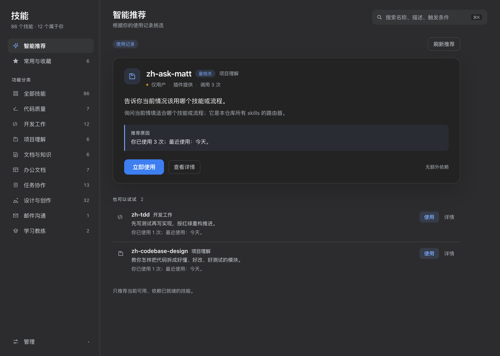
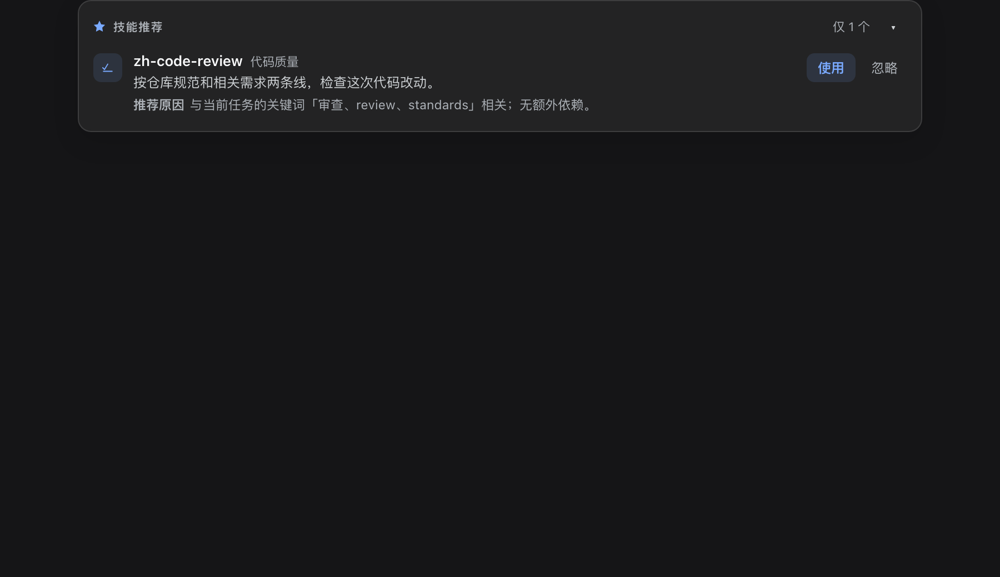
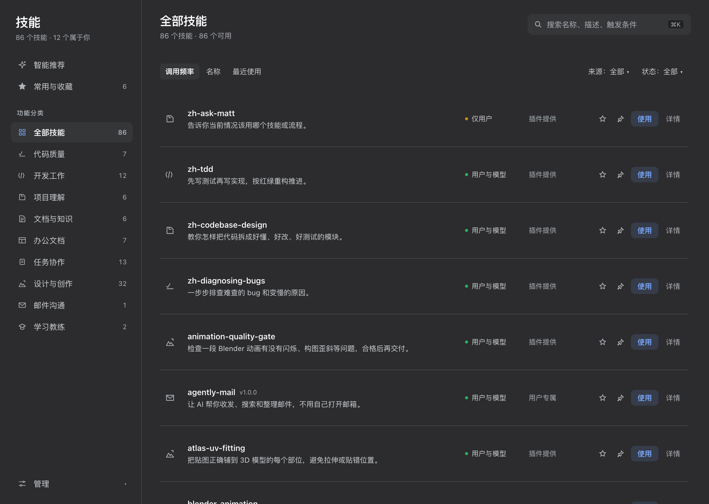
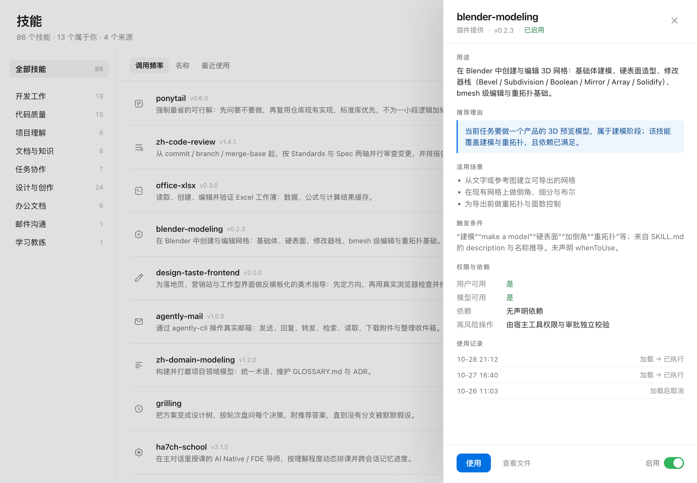

# dsh-charlotte

[English](README.en.md) | 中文

装在 [DeepSeek Harness](https://github.com/deepseek-ai/deepseek-harness) 里的技能启动器与技能库。

`dsh-charlotte` 只占一个「dsh-charlotte」入口：数据驱动的技能管理页（紧凑列表、真实功能分类、常用与收藏、右侧详情抽屉）、宿主侧实时推荐，以及「授权 → 加载 → 执行」全链路状态反馈。外部 Claude Code / Codex / ZCode / Cursor / Gemini 技能目录以只读方式挂载成一个 dsh 技能来源；启用、安装、删除与回收站能力都保留。

## 安装

桌面应用：设置 → 插件 → 添加插件 → 安装第三方插件，填 `https://github.com/AlpFallen/dsh-charlotte`（该入口同样接受 npm 包名和本地目录），装完重启应用，侧边栏设置按钮上方会出现「dsh-charlotte」入口。桌面 profile 由 App 托管，CLI 的 `dsh plugin --profile desktop add` 会被拒绝（`profile "desktop" is managed exclusively by the Electron application`）。

命令行（web profile）：

```sh
dsh plugin --profile web add github:AlpFallen/dsh-charlotte
```

本机运行环境是桌面 App 内置的 DSH `0.2.1-rc.3`（Node `24.21.0`），本插件在这套环境上加载运行，下面的截图也来自它；另外用 CLI 安装的 DSH `0.1.5-rc.2` 做过接口比对。宿主接口（`webServer.register` 的 `WebRoute`、`agent/pre-step` waterfall、`ctx.skills`）两版形状一致；客户端槽位（`conversation.input.dock`）在 0.2 里改过契约（`PropsRenderFactories`、草稿编辑器拆分），0.2.1-rc.3 上界面可用，更新的 0.2.x 版本未验证。

仓库里带着编译好的客户端产物（`client/client.js`），从 GitHub 安装不需要构建。本地开发时克隆后把 profile 依赖改成 `"link:/absolute/path/to/dsh-charlotte"` 再 `pnpm install`，然后重启应用。

## 截图

| 启动器首页 | 推荐卡（局部） |
|---|---|
|  |  |

| 全部技能 | 详情抽屉 |
|---|---|
|  |  |

## 功能

- **单一入口** — 侧栏只有「dsh-charlotte」一个入口。作用域、拖拽安装、回收站、刷新和语言收进 **更多** 菜单。
- **常用与收藏** — 首页顶部先给置顶、再给收藏、最后按真实调用频率补足（最多 4 条）；没有数据时整块不渲染，不编造示例。
- **真实功能分类** — 开发工作、代码质量、项目理解、文档与知识、任务协作、设计与创作、办公文档、邮件沟通、学习教练；每个技能归到哪一类由它自己的名称/描述/触发条件计算，详情里给出命中依据；没有「其他」类，零计数类不显示。
- **紧凑列表 + 侧边详情** — 行内是名称与版本、完整描述、可用状态、来源、收藏/置顶、使用、详情；详情走右侧抽屉，含推荐理由、适用/排除场景、触发条件、权限、依赖、版本、来源路径、真实使用记录与字段来源。
- **搜索、筛选、排序** — 搜索覆盖名称、描述、用途、关键词、触发条件与分类；可按分类、来源（项目级/用户专属/插件提供/系统内置）、状态筛选；排序只有调用频率、名称、最近使用——没有真实下载时间，所以不提供下载时间排序。
- **一次点击加载** — 点击 **使用** 后先在宿主校验（是否可见、是否启用、依赖是否满足），再把官方 `/技能名` token 放进当前或新建对话的输入框。不会发送消息、不会启动 Agent 回合；只有你发送后才注入技能指令。加载中再点一次即取消，失败显示宿主给出的真实原因。
- **如实的停用语义** — 对模型停用但用户可调用的技能仍然可用，并标记为「仅用户」；用户不可调用的技能不能使用。
- **插件自带技能** — 由 dsh 插件或 bundled provider 注册的技能现在也会以只读的 `插件` 卡片出现在同一网格里，带 provider 标签、只读详情和同样的 **使用技能** 加载流程。技能站只负责展示与加载，不能启停或删除；文件归提供它的插件所有。列表随 `/skills.registry` 返回，详情读 `/registry-skill`。
- **挂载外部技能** — 只读 provider 把 `~/.claude/skills`、`~/.codex/skills`、`~/.zcode/skills`、`~/.cursor/skills`、`~/.gemini/skills`（含 `~/.gemini/antigravity/skills`）、各工作区的 `.claude|.codex|.zcode|.cursor|.gemini/skills` 以及自定义 `extraDirs` 注册成 dsh 技能来源。文件原地不动：frontmatter 字段映射（`disable-model-invocation`、`user-invocable`、Codex `agents/openai.yaml` 策略、原始 metadata 保真）、非 kebab 名自动 slug、缺描述自动合成、改动热更新；符号链接形式的技能条目会跟随一次（`~/.claude/skills/<name> -> ../.agents/skills/<name>` 这种也能挂载）。
- **技能浏览** — 可写根目录（全局 `~/.dsh/skills`、共享 `~/.agents/skills`、每个工作区的 `<project>/.dsh/skills` / `.agents/skills`）与挂载目录、插件 provider 合成一个统一索引与列表。搜索覆盖名称、描述、用途、关键词与触发条件；启停对本地技能写 `disable-model-invocation` frontmatter，对挂载技能写覆盖表；删除进可恢复的回收站。
- **拖拽安装** — 把技能文件夹或 `.zip` 拖进安装面板，或用选择器。zip 由服务端解压；先校验（SKILL.md 需含 kebab-case `name` 与 `description`）并预览，确认后才写入；写入先暂存再改名。
- **回收站** — 删除的技能移入 `~/.dsh/charlotte/trash` 并记录来源，可在面板中恢复或清空。
- **中文界面：一句大白话 + 官方描述 + 专业版** — 技能名保持原文；列表里是一句高中生能看懂的中文简介；详情页依次展示技能官方描述（原文中文就放中文，没有中文就放英文原文）和一段中文专业版概述。两段中文优先用技能自己声明的 `simple-zh` / `professional-zh`，其次用与原文哈希严格匹配的目录（`locale/skills.zh.json`），原文变动后旧文案自动失效。
- **正文审计** — 每条技能读入的正文都会检查裸 ESC、Unicode 标签字符、双向控制符、零宽字符；详情页按条列出命中类型与数量，聚合结果在「诊断」里。
- **注入开销** — 每条技能给出 ≈token / 字符估算，CJK 与拉丁字符分开计数；标注为启发式估算，不是分词器。
- **调用台账** — 真实加载、执行、成功、失败的汇总，近 14 天加载趋势，每技能的 Success 与推荐采纳率；分母为零时显示「—」，不伪造比率。
- **标签** — 任意技能可加标签（回车添加、点标签删除），搜索覆盖标签。
- **共享池迁移** — 一键把可写根里的技能迁入共享池 `~/.agents/skills`，原位置留下相对软链；迁移先复制再验证再换链，失败自动还原。
- **诊断** — 被跳过的文件、无效 frontmatter、挂载扫描失败的原因集中展示，不再只进日志。
- **宽屏详情 + 复制正文** — 详情抽屉加宽到 760px，可一键复制技能正文。
- **中英双语界面** — 启动器表面（标题、搜索、筛选、列表、弹窗、推荐卡、更多菜单）可切换中英文并记住选择；中文模式下推荐理由也用中文。复用的安装与回收站主体保留现有中文文案。

## 实时推荐

宿主在 `agent/pre-step` 用你本轮的原文（以及它在真实技能元数据上的匹配结果）评估候选，把结果停在宿主侧；客户端等这轮回答结束（running 真→假）后才在输入框上方展示推荐卡。因此推荐不会打断生成，也不会把「推荐」当成「加载」。

- 流程：快速筛选（未启用/用户不可调用/依赖缺失直接排除）→ 语义匹配（中英 token + 双语同义词桥接 + 触发条件/关键词/描述字段加权）→ 相关度排序 → 权限与依赖检查 → 推荐。
- 价值门槛：寒暄、简单问答、过短提示不推荐；默认只推最相关的 1 个，第二/第三个必须接近最高分（`comboRatio`）且不重复功能。
- 去重与打扰控制：同一任务不重复推同一技能；「忽略」后本次任务不再出现，只有需求实质变化才重新评估；冷却时间、每会话次数、阈值都可配置。
- 卡片只显示名称、用途摘要、推荐原因与 **使用 / 忽略**；点「使用」走与管理页相同的授权加载链路。

## 「加载」到底做了什么

DSH 没有 per-Session Skill attachment，也没有不产生模型回合就能注入技能指令的宿主 API。受支持的非执行准备方式就是官方的 `/name` composer token：加载会把 `/技能名 ` 放进目标对话的输入框，然后关闭启动器。不会发送消息、不会启动 Agent 回合、不会插入隐藏用户消息。你输入自己的任务并发送时，宿主才把 token 转成技能指令；发送前把 token 删掉，技能就不会生效。

状态是分阶段的：发现 → 推荐 → 待确认 → 加载中 → 已加载 → 执行中 → 成功 / 失败 / 已取消。「已加载」只代表输入框里确实有 token；「执行中」必须是宿主在 pre-step 真的看到技能指令注入；「成功」是注入过技能的回合正常结束。失败时展示真实原因（权限不足、依赖缺失、输入框忙、服务缺失），不伪造成功。

## 配置

均可选，写在 profile 补丁层的 `dsh-charlotte` 插件行下；未知键启动即报错。

```yaml
plugins:
  dsh-charlotte:
    sources:
      claude: true                      # ~/.claude/skills + <project>/.claude/skills
      codex: { project: false }          # 单来源细项开关
      zcode: true
      cursor: true
      gemini: true
    extraDirs:
      - { path: ~/my-skills, label: mine, rank: 300 }
    watch: true
    slugifyNames: true
    synthesizeDescription: true
    recommend:                          # 推荐参数，全部可选；非法值启动即报错
      enabled: true
      maxItems: 3                       # 单次最多 3 个
      threshold: 0.18
      minIntentChars: 10
      minValueScore: 0.2
      cooldownMs: 45000
      maxPerSession: 8
      dedupeJaccard: 0.6
      sameTaskJaccard: 0.55
      comboRatio: 0.75
```

## 安全模型

- 技能写入只落在上述可写根目录，以及 dsh-charlotte 自己的状态目录 `~/.dsh/charlotte/`；每个路径在规范化后做包含性检查，复制不跟随 symlink，上传拒绝路径穿越。
- 外部 agent 目录只读挂载；开关状态存在 dsh-charlotte 的覆盖表里，不写回它们的 `SKILL.md`。
- 变更类 HTTP 接口拒绝跨源请求；API 与 GUI 同一本地服务。
- 加载/启停/收藏都在服务端复核：`/use` 重新检查可见性、启用状态与依赖；`loaded` 事件只接受刚被授权的会话；前端展示不替代权限检查。
- 技能使用授权不等于具体操作授权：删除文件、发送消息、提交数据等高风险动作仍由 DSH 工具权限与审批独立校验。
- 挂载与上传的技能都是第三方内容，启用前请先审阅。

## 状态

0.8.0。改宿主（`lib/`）要完全退出 App（含托盘）再重开；改客户端（`revamp/`、CSS）只需 `npm run build` 后刷新页面。运行状态（`state.json`、`overrides.json`、`enrich-cache.json`、`trash/`）在 `~/.dsh/charlotte/`，不进仓库。

## 开发

```sh
npm install
npm run build                  # 从 client.baseline.js + revamp/ 重建 client/client.js
npm test                       # 30 客户端 + 16 宿主契约 + 43 索引/推荐/中文化集成
DSH_WEB_URL=http://127.0.0.1:<当前端口> npm run check:zh   # 两段中文的覆盖与哈希校验
node scripts/host-smoke.mjs    # 只测宿主契约：配置、根目录、provider、旧 API
node scripts/host-index-smoke.mjs  # 索引、分类、推荐、权限、依赖、目录安装
node scripts/render-probe.mjs  # 可选：真 React 渲染探针
```

客户端是已检入的编译基线（`client/client.baseline.js`）上的切片补丁，由 `scripts/build-client.mjs` 拼装，源片段在 `revamp/`；宿主是 `lib/` 下的普通 ESM。

## 许可证

MIT。`lib/mount/` 下 MIT 许可的第三方代码声明见 [THIRD_PARTY_NOTICES.md](THIRD_PARTY_NOTICES.md)。
